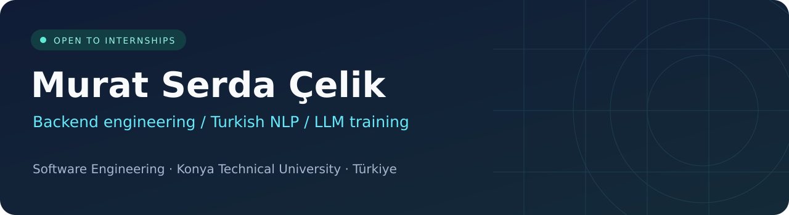
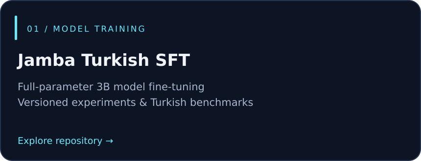
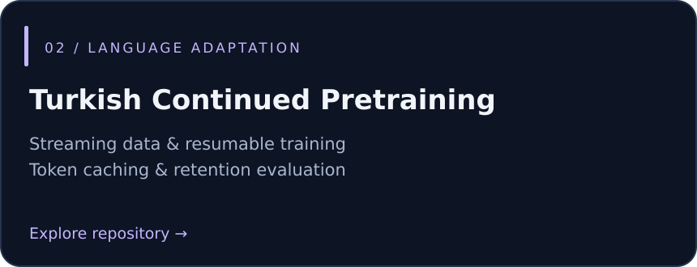
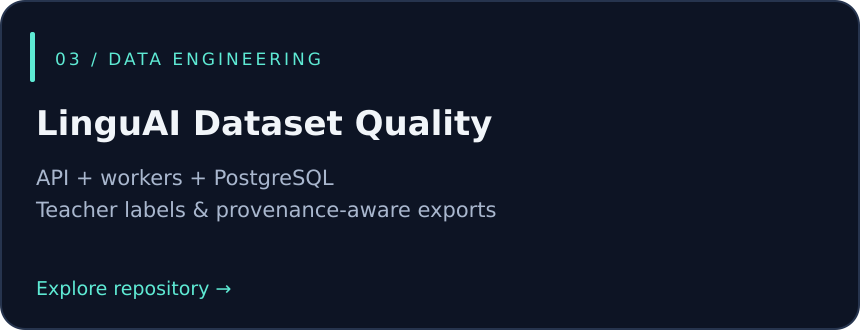
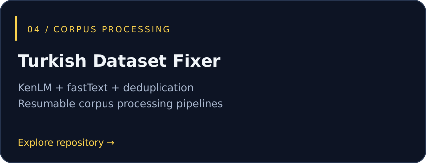

  

  
  
  

### Building across software and language models

I'm a final-year **Software Engineering student at Konya Technical University**. I build backend services and data pipelines, and work on **Turkish language models through LinguAI**. My experience includes an internship at **OBSS** focused on AI integration and web development.

**Looking for a long-term internship** in backend, full-stack, AI/ML, NLP, or data engineering.

### Project dashboard

<table>
<tr>
<td width="50%"> </td>
<td width="50%"> </td>
</tr>
<tr>
<td width="50%"> </td>
<td width="50%"> </td>
</tr>
</table>

### GitHub activity · last 31 days

### Websites & published work

  <a href="https://linguai.tech/"><strong>LinguAI ↗</strong></a> — Turkish NLP and language model work. 
  <a href="https://huggingface.co/serda-dev/Jamba2-3B-Turkish"><strong>Jamba2-3B-Turkish ↗</strong></a> — Published model weights and model card. 
  <a href="https://github.com/serda-dev/jamba-sft-turkish/tree/main/results"><strong>Evaluation reports ↗</strong></a> — Benchmark results, protocols, and limitations. 
  <a href="https://github.com/serda-dev/linguai-teacher-model"><strong>LinguAI Teacher Service ↗</strong></a> — Containerized model serving with a structured API.

### Toolkit

  

**Engineering priorities:** reproducible experiments · meaningful tests · dataset provenance · documented trade-offs

Model reports include baseline comparisons and unmet acceptance criteria alongside improvements.
